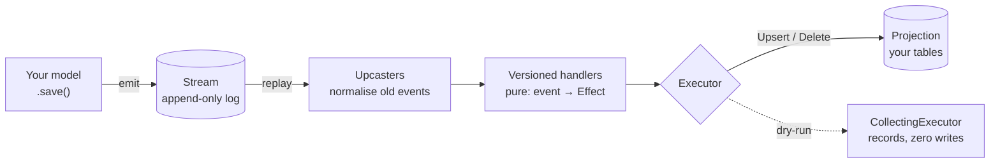

# Examples & concept coverage

This page is the **map of the `examples/` directory**: what each runnable demo
proves, the one command that runs it, and a matrix of which rakaia concept each
one exercises. It's written for two readers:

- **Humans** evaluating or learning rakaia — start at the [mental model](#the-mental-model),
  then run the demo closest to your problem.
- **AI agents / contributors** navigating the repo — jump to the
  [concept → example matrix](#concept-example-coverage-matrix) to find a working
  reference for any public API, and to the [orientation](#orientation-for-contributors)
  for where things live and the conventions every example follows.

Every demo is **assertion-backed**: it prints what it proves and fails loudly if
the behaviour regresses. Running them is the fastest way to confirm the library
works after a change.

!!! note "Machine-readable companion"
    A structured, cross-linked version of this page lives as an
    [Open Knowledge Format](https://github.com/GoogleCloudPlatform/knowledge-catalog)
    bundle at [`okf/`](https://github.com/joshbrooks/rakaia/tree/main/okf) in the
    repo — one concept document per example and per concept group, for agents and
    tools to consume.

## The mental model

Rakaia is two layers, and the examples split along that line.

1. **The protocol layer** — a [Durable Streams](protocol.md) server: an
   append-only, ordered, offset-addressed log (`StreamStore`) with producer
   fencing, close semantics, and subscriber cursors. Zero dependencies, no
   Django. See [`protocol_streams`](#standalone-no-django).
2. **The event-sourcing layer** (`django_rakaia`) — your database tables
   (*projections*) are *derived* from the log by pure,
   [versioned handlers](glossary.md#versioned-handler), so you can
   [replay](glossary.md#replay) history and get time-correct results:



New to the vocabulary (*projection*, *handler*, *upcaster*, *replay*, *effect*)?
The [glossary](glossary.md) defines every term linked above.

## Run everything

```bash
just install     # sync all dependency groups (dev + django + docs + prod)
just demo        # the scripted headless tour, with narration
```

Individual demos are listed in the tables below. Every Django demo migrates
first; the recipe and the command inside it are both idempotent and re-runnable.

## The examples

### Live SSE (Django, browser)

Real-time demos — run the server, open the URL, watch events stream in.

| Example | Proves | Run |
|---|---|---|
| [`chat`](https://github.com/joshbrooks/rakaia/tree/main/examples/chat) | `@stream_model`, multi-stream events per save, live SSE fan-out | `just dev` → `http://localhost:8000` |
| [`polyglot`](https://github.com/joshbrooks/rakaia/tree/main/examples/polyglot) | Language-scoped streams, live-editable translations over SSE, served from the file-backed store with no database log and no channel layer | `just polyglot-dev` → `http://localhost:8001` |

### Headless event-sourcing (Django, scripted)

One command each: seed a stream, replay it, assert the projection.

| Example | Proves | Run |
|---|---|---|
| [`orders`](https://github.com/joshbrooks/rakaia/tree/main/examples/orders) | Versioned handlers, `effective_from/to`, upcasters, dry-run, `ExternalEffect`, `Update` | `just orders-demo` |
| [`formkit_submissions`](https://github.com/joshbrooks/rakaia/tree/main/examples/formkit_submissions) | Projections/fan-out, `reconcile_children`, migration parity vs a direct `to_model()` | `just formkit-demo` |
| `formkit_submissions` (stream) | Arrow-flip: append log = source of truth → latest-version projection (`project_latest`) | `just formkit-stream-demo` |
| [`projection_cookbook`](https://github.com/joshbrooks/rakaia/tree/main/examples/projection_cookbook) | Staged replay, `ProjectionReader`, `register_simple`, `diff_effects_against_rows` verification | `just cookbook-demo` |
| [`partisipa_history`](https://github.com/joshbrooks/rakaia/tree/main/examples/partisipa_history) | pghistory-parity audit log + peak-snapshot recovery from an enveloped stream | `just partisipa-history-demo` |
| [`partisipa_staged`](https://github.com/joshbrooks/rakaia/tree/main/examples/partisipa_staged) | Staged replay resolving late-arriving cross-form links | `just partisipa-demo` |
| [`partisipa_close`](https://github.com/joshbrooks/rakaia/tree/main/examples/partisipa_close) | Close-precondition state machine decided purely from projected state; stage reducers | `just partisipa-close-demo` |
| [`partisipa_merge`](https://github.com/joshbrooks/rakaia/tree/main/examples/partisipa_merge) | `merge_replay` of N streams into one deterministic order; cross-stream rollup | `just partisipa-merge-demo` |
| [`partisipa_repeaters`](https://github.com/joshbrooks/rakaia/tree/main/examples/partisipa_repeaters) | Nested-repeater tree reconcile — no deep orphans, no double-count | `just partisipa-tree-demo` |
| [`partisipa_intake`](https://github.com/joshbrooks/rakaia/tree/main/examples/partisipa_intake) | The consuming loop — `django_consumer` / `run`, a durable reading position, and an outcome per refused, failed or skipped event | `just intake-demo` |
| [`partisipa_pipeline`](https://github.com/joshbrooks/rakaia/tree/main/examples/partisipa_pipeline) | One suku's forms through a six-step pipeline, saved one at a time, then rebuilt and compared with live — the code behind the [explainers](explainers/index.md) | `just pipeline-demo` |
| [`stream_coverage`](https://github.com/joshbrooks/rakaia/tree/main/examples/stream_coverage) | `check_stream_coverage` finding a stream that fell behind its table — rows loaded with `bulk_create` (missing) and changed with `update()` (stale) — and passing again after repair | `just coverage-demo` |
| [`consumer_rebuild`](https://github.com/joshbrooks/rakaia/tree/main/examples/consumer_rebuild) | A consumer whose stream was deleted and recreated (`Consumed.needs_rebuild`), a `transient` apply error that is retried, and a pass that dies halfway and converges on re-run | `just consumer-rebuild-demo` |
| `polyglot` (migrate) | `migrate_stream` keeping offsets so a consumer resumes, and renumbering so it stops as `replaced` (`adopt_generation`) | `just migrate-consumer-demo` |
| `orders` (hermeticity) | The impure-handler warning and `RAKAIA_STRICT_HANDLER_FINGERPRINTS`, plus drift through a `functools.partial` that a closure misses | `just hermeticity-demo` |
| [`two_workers`](https://github.com/joshbrooks/rakaia/tree/main/examples/two_workers) | Two worker processes under one consumer name: the cursor row lock (the second waits rather than applying the same events), a forward-only commit refusing a rewind, and a resume that reads the delta rather than the log | `just two-workers-demo`, `just two-workers-demo-pg` |

### Standalone (no Django)

Scripts with no Django and no server; `sqlite_replay` writes a SQLite file, the
rest need no database at all. These cover the half of rakaia that isn't Django.
Every one is zero-dependency except `formkit_emission`, which pulls formkit-ninja
in through `uv run --with`, because driving another library's real seam is the
whole point of it.

| Example | Proves | Run |
|---|---|---|
| [`protocol_streams`](https://github.com/joshbrooks/rakaia/tree/main/examples/protocol_streams) | `StreamStore` append/read, `append_if_changed`, producer fencing, `close`, `poll` subscriber cursors, CDN cursors | `just protocol-demo` |
| [`multi_owner`](https://github.com/joshbrooks/rakaia/tree/main/examples/multi_owner) | `Ref`/`RefResolver`, `reconcile_aggregate(owns=)`, `reconcile_by_key(retire=)`, `check_disjoint_defaults`, routing `ExternalEffect`s | `just multi-owner-demo` |
| [`sqlite_replay`](https://github.com/joshbrooks/rakaia/tree/main/examples/sqlite_replay) | `SqliteExecutor` and `SqliteProjectionReader`: replay into a SQLite file, a second connection reading it, a failed batch rolling back whole | `just sqlite-replay-demo` |
| [`formkit_emission`](https://github.com/joshbrooks/rakaia/tree/main/examples/formkit_emission) | formkit-ninja's own `emit`/`wire` decomposition appended to a rakaia log; an absent key and an explicit `null` coming back as different events; `schema_version` never fabricated | `just formkit-emission-demo` |

## Concept → example coverage matrix

Which example to read for a working reference to each public API. `—` means no
example exercises it yet (see [known gaps](#known-gaps)).

### Protocol layer

| Concept | Demonstrated by |
|---|---|
| `StreamStore` append / read / offsets | `protocol_streams`, and every Django demo indirectly |
| `append_if_changed` / `snapshots_equal` (no-op suppression) | `protocol_streams` |
| Producer fencing (`ProducerAccepted`/`Duplicate`/`SequenceGap`/`StaleEpoch`/`InvalidEpochSeq`) | `protocol_streams` |
| Stream `close_stream` / `CloseResult` | `protocol_streams` |
| Subscriber cursors — `poll`, `Poll`, `PollStatus` | `protocol_streams` |
| CDN cursors — `calculate_cursor`, `generate_response_cursor`, `CursorOptions` | `protocol_streams` |

### Event envelope & provenance

| Concept | Demonstrated by |
|---|---|
| `AppendOptions(label=…, metadata=…)`, `provenance()` | `formkit_submissions`, `formkit_submissions` (stream) |
| An absent JSON key kept distinct from an explicit `null` | `formkit_emission` |
| History read-model — `history_effects`, materialized audit rows | `formkit_submissions`, `partisipa_history` |
| Peak-snapshot recovery (blank-save repair, hand-rolled over audit rows) | `partisipa_history` |

### Versioned handlers, upcasters, replay

| Concept | Demonstrated by |
|---|---|
| `register_handler`, `effective_from`/`effective_to` (time-correctness) | `orders`, `formkit_submissions` |
| `register_simple`, `match_field` routing | `projection_cookbook` |
| Upcasters — `register_upcaster` (schema evolution) | `orders`, `formkit_submissions` |
| Drift detection — `on_drift="raise"` | `orders` |
| Handler fingerprints — impure-handler warning, `RAKAIA_STRICT_HANDLER_FINGERPRINTS`, partial vs closure | `orders` (hermeticity) |
| `replay`, single-stage | most Django demos |
| Staged replay (`stage=`) + `ProjectionReader` | `projection_cookbook`, `partisipa_staged`, `partisipa_close`, `partisipa_merge` |
| `merge_replay` (multi-stream deterministic order) | `partisipa_merge` |
| Stage reducers (via `{"reduce": […]}` stage config) | `partisipa_close`, `partisipa_merge` |
| `register_reducer` (the public API), and a save that replays one event (`start_seq`/`end_seq`) through the same handlers as a rebuild | `partisipa_pipeline` |

### Effects & executors

| Concept | Demonstrated by |
|---|---|
| The effect types: `Upsert`, `Update`, `Delete`+`Exclude`, `ExternalEffect` | `orders`, `partisipa_repeaters`, `multi_owner`, `partisipa_pipeline` |
| `Retire` — soft delete whose stamp is the triggering event's timestamp, never the replay clock | `partisipa_close`, `multi_owner` |
| `CollectingExecutor` (dry-run) | `orders`, `projection_cookbook` |
| `DjangoExecutor` | every Django demo |
| `SqliteExecutor` / `SqliteProjectionReader` (a real database, no Django) | `sqlite_replay` |
| `Ref` / `RefResolver` (bind FK to a sibling's generated key) | `multi_owner` |
| `check_disjoint_defaults` (multi-owner guard) | `multi_owner` |
| `diff_effects_against_rows` (replay-vs-rows verification) | `projection_cookbook` |
| `rebuild_and_verify` (guarded rebuild into a scratch alias, diffed table against table) | `partisipa_pipeline` |

### Projections & fan-out

| Concept | Demonstrated by |
|---|---|
| `reconcile_children` (positional fan-out, orphan-safe) | `formkit_submissions`, `partisipa_close`, `partisipa_repeaters`, `partisipa_pipeline` |
| `project_latest` (subject → latest snapshot) | `formkit_submissions` (stream) |
| `reconcile_aggregate` (grouped rollup) + multi-owner `owns=` | `multi_owner` |
| `reconcile_by_key` (composite natural key) + soft-delete `retire=` | `multi_owner` |

### Django integration

| Concept | Demonstrated by |
|---|---|
| `@stream_model`, `create_stream_event`, multi-stream events | `chat` |
| Live SSE broadcast (Channels) | `chat` |
| Durable `DjangoStreamStore` (log persisted in the DB) | `formkit_submissions` (stream) |
| File-backed `JsonlStreamStore` under Django, with the protocol server mounted alongside it for live SSE | `polyglot` |
| The consuming loop — `Consumer`, `django_consumer`, `run(on_error=…)`, and naming a record with `subject_of` / `sequence_of` | `partisipa_intake` |
| A consumer meeting a replaced stream (`Consumed.needs_rebuild`) and a transient apply error (`Consumed.transient`) | `consumer_rebuild` |
| Durable reading position (`ConsumerCursor`, `load_cursor`) and the run's status | `partisipa_intake`, `consumer_rebuild`, `two_workers` |
| Two workers under one consumer name — the cursor row lock, and a forward-only commit (`CursorMovedBackwards`) | `two_workers` (Postgres leg) |
| Resuming from a saved cursor reads the delta, not the whole log | `two_workers` |
| The outcome record — `Outcome`, `DjangoOutcomeStore`, the `append`/`project` stages and all three statuses | `partisipa_intake` |
| `migrate_stream` keeping a consumer's offsets and stamp (`adopt_generation`), or renumbering so it stops | `polyglot` (migrate) |
| Stream coverage — `RAKAIA_COVERAGE_CHECKS`, `manage.py check_stream_coverage`, missing and stale rows from a `changed_field` column | `stream_coverage` |

### Known gaps

No example exercises these yet — a good place to contribute a demo:

- A consumer that stops on a rewound stream (`Consumed.needs_rebuild`): the
  `consumer_rebuild` demo recreates (replaces) a stream, but never rewinds one.
- `@stream_model` on a closed stream (`StreamClosed`) and on the memory or file
  store: `polyglot` wires its own signal instead.
- `reconcile_tree` (the `partisipa_repeaters` spike hand-rolls the equivalent
  with `Delete`+`Exclude`).
- Reading events by tag (`read_tagged`, `TaggedReads`): no example covers it; the
  contract suite `rakaia/testing/tagged_reads_contract.py` proves it.
- `replay_stream` (the Django convenience wrapper).
- `DjangoExecutor(skip_unchanged=True)`.
- `RecordingExecutor` — applying for real while keeping the effects. The demos
  either write (`DjangoExecutor`) or preview (`CollectingExecutor`); none needs
  both at once, which is the case this executor exists for.
- `migrate_all` — copying every stream at once. `migrate_consumer` copies one.
- `DjangoExecutor(batch_updates=True)` and `DjangoExecutor(normalizers=...)`.
- `ChangeLabel` and `EnvelopeMetadata` — the named types for an event's change
  label and metadata keys. They annotate fields every example already writes, but
  no example imports them or shows an editor offering the known values.
- `ServerOptions(read_page_size=...)` and the `RAKAIA_READ_PAGE_SIZE` setting.
  Every example that serves the protocol takes the default page of a thousand,
  and none holds a stream long enough for a read to stop short.
- Writing a store or executor outside this repo: `plan_appends`, `page_of`,
  `apply_effects` and the `rakaia.testing` suites. [Write your own
  store](write-your-own-store.md) holds a worked store and a test runs it against
  `StoreContract`, but no `examples/` demo does, and nothing shows a custom executor.
- `RAKAIA_STORE` naming a store of your own by its import path: no example serves
  one; `tests/test_django_rakaia/test_store_by_dotted_path.py` is the only cover.
- `SqliteExecutor` with a handler that emits a value JSON cannot hold (a `Decimal`,
  a `datetime`): `sqlite_replay` keeps money in cents and shows only the batch that
  fails on such a value rolling back. The `orders` handlers would need converting
  before they could replay into SQLite. Three more JSON round-trip limits have no
  demo: a column nothing wrote raises `AttributeError` where Django gives `None`,
  tuples come back as lists, and a label spelled with different case writes to the
  same table but reads, updates and deletes through it find nothing.
- `CollectingExecutor`'s checks and `InMemoryProjections`' differences from the
  database (a column nothing wrote, type coercion, NOT NULL). The demos dry-run
  without tripping a check, and none shows one failing, or a case where the
  in-memory rows and the database differ.

- `ServerOptions(authorize=..., allowed_origins=..., max_body_bytes=...,
  sse_max_seconds=...)` and their `RAKAIA_` settings. Every example that serves the
  protocol runs open, which is the default; the tests in `whats-new.md` section 33
  are the only cover. Two side effects of the 0.10.0 server changes: `chat` now signs
  every visitor in as a demo user (`chat/middleware.py`), because the dashboard's live
  feed needs a login and the sample has none; and `polyglot` tails its stream from
  `offset=0`, so each of its connections, now closed every 60 seconds, replays the
  whole stream on reconnect. It stays correct but costs more as the stream grows.
- `RAKAIA_PERMANENT_STREAMS` and the `permanent=True` argument on
  `StreamStore` and `JsonlStreamStore`, its three refusals (`ExpiryNotAllowed`, and
  `DeleteNotAllowed` for both a client's `DELETE` and a Python `delete()` without
  `force=True`) and `manage.py prune_orphan_events`. No example turns the
  switch on or deletes a stream, so none shows a `DELETE` being refused or a
  deleted stream's events going with it.
- `AppendOptions(tags=..., correlation_id=...)`, `AppendResult.event_id`, the
  `StreamEvent.objects.tagged()` / `.correlated()` lookups and the `api/events/`
  endpoint. No example records an incident or looks one up; the tests in
  `tests/test_django_rakaia/test_event_tags.py` are the only demonstration.
- `DriftLedger` as an object. `orders` triggers drift detection via
  `on_drift="raise"` but never reads the ledger.
- The file-backed and in-memory outcome stores (`JsonlOutcomeStore`,
  `InMemoryOutcomeStore`) as an example's own choice. `partisipa_intake` covers
  the loop and the record, and keeps both in the database because what it is
  showing is what survives a restart; nothing under `examples/` keeps outcomes in
  a file or in memory.
- Reason codes for a failure rakaia raised (`RakaiaError`, `REASON_CODES`). The
  gap is narrower than it was: `partisipa_intake` runs the loop and records real
  failures, so there are codes sitting in its table. What no example does is
  *read* one — catch the base type, or branch on the code a record carries — which
  is what an operator's own tooling would do with them.
- Outcome retention. `manage.py prune_outcomes` deletes old failure records
  (`docs/deployment.md`), and `partisipa_intake` now leaves four records for such
  a demo to prune — but no example runs it, so the operator's side of the outcome
  table is still undemonstrated.
- Stream coverage with the change time taken from somewhere other than the
  table. `stream_coverage` finds missing and stale rows against an `updated_at`
  column, but no example points an entry at a `queryset` function that works the
  time out from a history table, and none calls `stream_coverage` from Python
  rather than through the command.

## Orientation for contributors

**Anatomy of an example.** A Django example (`examples/<name>/`) is a minimal
Django project:

- `<name>_project/settings.py` — `INSTALLED_APPS` includes `django_rakaia` and
  the example app; `RAKAIA_STORE` selects the in-memory, durable or
  file-backed store.
- `<app>/models.py` — the projection tables (the *derived* state).
- `<app>/handlers.py` — the pure `event → Effect` handlers, registered with
  `@register_handler` / `@register_simple` / `@register_reducer`.
- `<app>/seed.py` — the sample events the demo replays.
- `<app>/management/commands/demo_<name>.py` — the runnable walkthrough.

A standalone example (`examples/protocol_streams/`, `examples/multi_owner/`) is
just a `demo.py` script that imports `rakaia` and the stdlib — no Django, no DB.

**Conventions every example follows:**

- **Migrate-first.** Each `demo_*` management command calls `migrate` itself, so
  it works run directly *or* via `just`. The `db.sqlite3` files are gitignored
  scratch state — never a committed fixture.
- **Assertion-backed.** A demo ends with `All … checks passed ✓` or a traceback;
  there is no "looks right" path. Re-running is idempotent (many take `--twice`).
- **Deterministic.** Replays produce the same projection every time — no
  `timezone.now()` inside a handler; event timestamps come from the envelope.

**Adding an example:** copy the closest existing project, add a `just <name>-demo`
recipe (migrate-first), a `README.md`, and — if it demonstrates a headline
feature — a row in the [what's-new tour](whats-new.md) and this page's matrix.

Run `just install && just demo` before pushing; CI runs `ruff check`,
`ruff format --check`, `pytest`, and `zensical build`.
