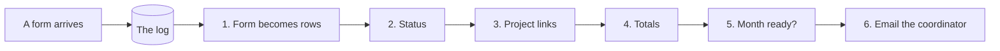

# One form, step by step

These pages follow one village's month of forms through a small pipeline built
like Partisipa's. The village is called a *suku*. Each page covers one step and
says what it does, what goes wrong without it, and how to watch it happen.

## The story

Fatuberliu is running two projects in March: a spring intake for water and some
culverts for a road. Over the month, seven forms come in:

1. The water progress report arrives, before the water project's registration form.
2. The road project's registration form arrives, creating the project.
3. The road progress report arrives, and it is over budget.
4. The water project's registration form finally arrives.
5. The road report is sent again with the extra culvert taken out.
6. The water report is approved.
7. The road report is approved.

At the end of the month the coordinator wants to know whether Fatuberliu can
close March. That depends on every one of those forms.

## The pipeline

Each form is written to the **log** first: a record kept in the order things
happened, which is never edited. The tables people read are then worked out from
the log, one step after another:



| Step | What it does | Page |
|---|---|---|
| A form arrives | The form is written to the log, with who sent it | [A form arrives](a-form-arrives.md) |
| 1. Form becomes rows | A project form becomes a project; a report becomes a report and its lines | [Forms become rows](forms-become-rows.md) |
| 2. Status | An approval becomes the report's status | [Status and project links](status-and-project-links.md) |
| 3. Project links | A save assigns each report to the registration for its suku and output, and records why | [Status and project links](status-and-project-links.md) |
| 4. Totals | A report's lines are added up | [Forms become rows](forms-become-rows.md) |
| 5. Month ready? | The month can close when every report is approved, linked and within budget | [Checks and emails](checks-and-notifications.md) |
| 6. Email the coordinator | An approval sends an email | [Checks and emails](checks-and-notifications.md) |
| Rebuild and compare | Every table is rebuilt from the log and checked against the live one | [Rebuild and compare](rebuild-and-compare.md) |

## One list, two ways to run it

The tables get filled in two ways:

- **A save** runs when one form arrives. It runs the steps for that form only, straight away.
- **A rebuild** starts from empty tables and runs every step over the whole log.

You need the rebuild when a step was wrong and has been fixed, when a database is
restored, or simply to check that the tables still say what the log says.

The trouble starts when a save and a rebuild are written as two separate pieces
of code. They drift apart, and nobody notices until a rebuild gives a different
answer from live. So in this example both of them work from **one list of
steps**. A step that a rebuild must not repeat, such as sending an email, says so
on the list and gives the reason.

## Try it

```sh
just pipeline-demo
```

The command saves the seven forms one at a time and prints the tables after
each save. It then rebuilds everything and compares the result with live. Every
claim it prints is checked, and the command fails if one stops being true. To
stop after a given step, add `--until` and the step's name, for example
`just pipeline-demo --until totals`.

## Appendix

- **Code:** `examples/partisipa_pipeline`.
  - `pipeline/steps.py` holds the step list and every handler.
  - `pipeline/routes.py` holds the save and the rebuild.
  - `pipeline/forms.py` holds the seven forms.
- **The step list belongs to the example, not to rakaia.** Rakaia sees the
  handlers each step registers, never the list. The idea comes from
  partisipa-import's proposal *A save and a rebuild run one list of steps*
  (catalpainternational/partisipa-import GitHub #3443, open when this was
  written). joshbrooks/rakaia GitHub #374 asks for rakaia to take the list
  itself.
- **Steps map to stages.** Steps 1 to 3 are stage-0 handlers; step 3 also has a
  part only a save runs, which records the assignments. Step 4 is a stage-1
  reducer, step 5 a stage-2 reducer, and step 6 a stage-3 handler. A
  replay runs every stage-0 handler over the whole batch before any stage-1
  work starts, and that is what makes the order hold. See
  [Stage / staged replay](../glossary.md#stage-staged-replay).
- **Mostly one handler per step, on both routes.** Every step's handlers run on
  a save and on a rebuild. The one exception is deciding a report's project,
  which only a save does; a rebuild replays what the save recorded. That is
  where rakaia GitHub #374 points. partisipa-import's list (its open PR GitHub
  #3443) shares the order and the inventory between its two routes, but most of
  its steps have a separate function for each route, so do not read the example
  as a description of how that list works today.
- **One stream for the whole suku.** Partisipa keeps one stream per form type.
  This example keeps all of them in one stream, `forms/fatuberliu`, because
  `rebuild_and_verify` checks one stream at a time. For several streams, see
  [Multi-stream merge](../multi-stream-merge.md).
- **Tests:** `tests/test_examples/test_partisipa_pipeline.py` runs both routes
  over in-memory tables. The demo runs them against Django.
